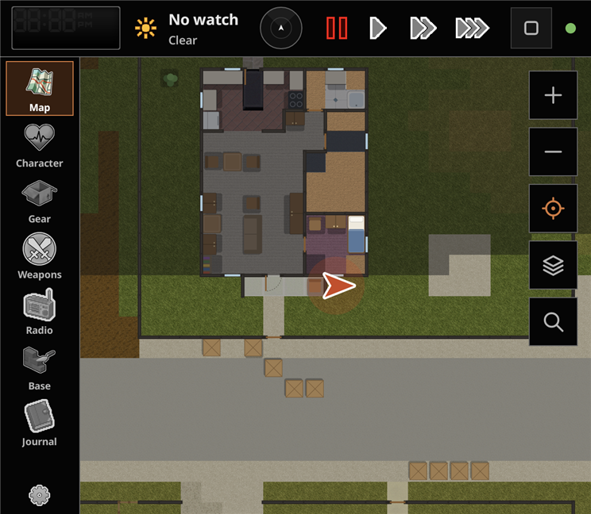
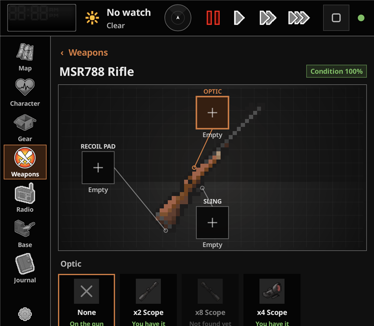
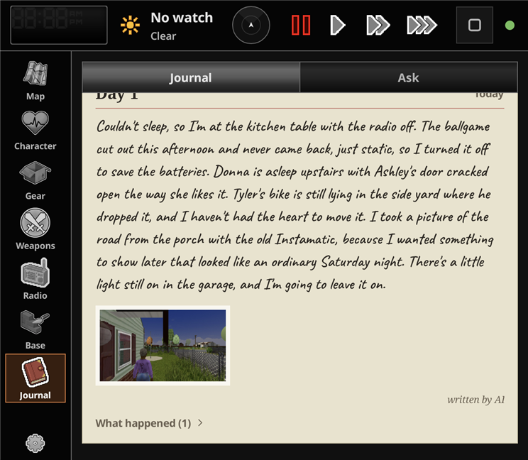
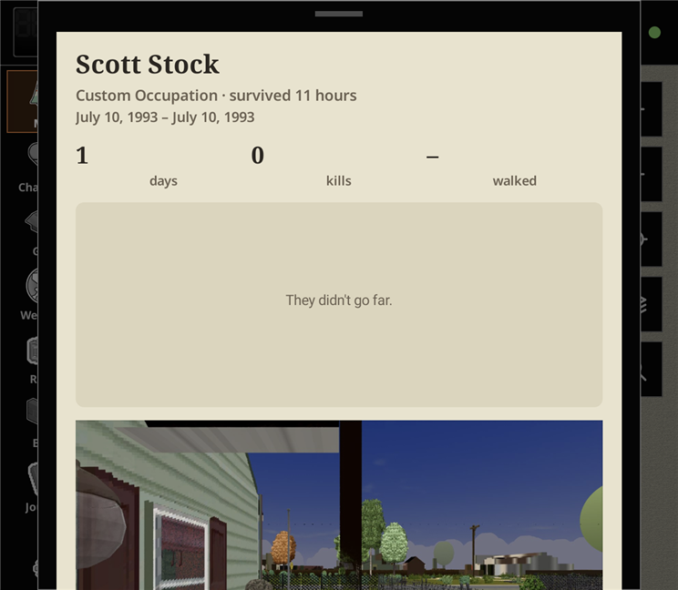
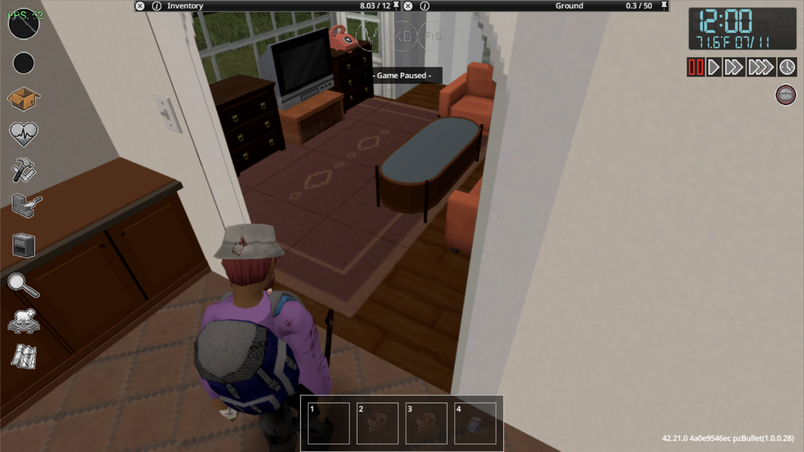
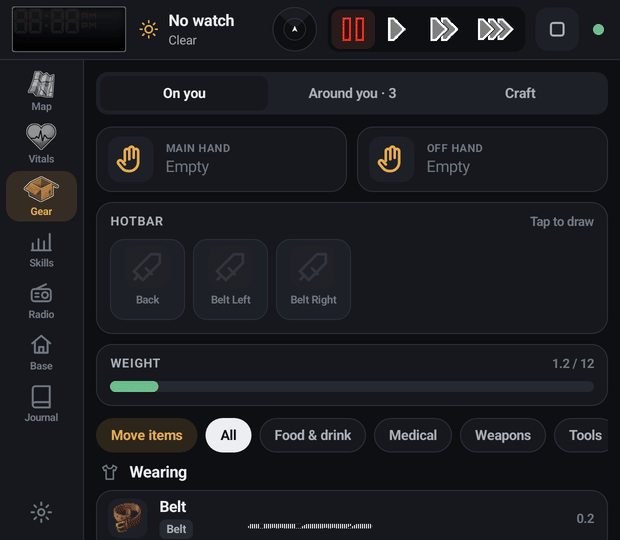

# Knox Link

**A second screen for Project Zomboid.** Your map, your body, your bag, the radio, your base and your
journal — on the bottom screen of a dual-screen handheld, a phone, a tablet or a second monitor, live,
while you play.

Knox Link is made of two Project Zomboid mods (a Lua mod and a small Java server add-on) and two
clients: a native Android app (built for dual-screen handhelds such as the AYN Thor) and a web app
that any browser on your network can open.

**Made and tested on an AYN Thor Max**, with Project Zomboid running on the handheld itself (no PC, no
streaming) on the top screen and Knox Link on the bottom one, in the game's normal view and in 3D. See
[Tested on](#tested-on).

> Not affiliated with The Indie Stone. Knox Link reads the game's own artwork from your copy of the
> game while it runs; it doesn't ship any game files.

| | |
| --- | --- |
|  |  |
|  |  |

*On the bottom screen of an AYN Thor, next to the game in Project Viewpoint's 3D view:*



---

## What's on the second screen

| Tab | What it does |
| --- | --- |
| **Map** | The game's world map, drawn in the paper style of the in-game map, following you. Fog of war for places you haven't seen. Press and hold to set a waypoint (with an arrow in the game), draw a symbol or write a note on your map — it's the same map the game saves — or set your base. Teammates in multiplayer, as the server allows. **Zoom all the way in for a live floor plan** of what your character has seen around them: walls, doors (open or shut), windows (open, broken, barricaded), stairs and furniture, with the zombies they've noticed on it — made for first person, where the game's own overview is gone. The buildings you've searched get a tick, and the map remembers **where you left your car**. |
| **Where did I see…?** | The map's search: Knox Link remembers every container your character looked in, as you go — shelves, fridges, bodies, car trunks, the floor. Ask for "hammer" or tap *Medicine*, and get what you saw, nearest first: in which container, which room, which town, how long ago; tap one to see it on the map. Only what this character saw: a new character remembers nothing. |
| **Character: Health** | The game's health-panel body with every wound, moodles with the game's icons, quick actions (bandage, eat, drink, painkiller, light, weapon, rest — or sleep when a bed is near). Tap a hurt body part: what's wrong with it **in the game's own words** (scratched, laceration, deep wound, bitten, glass lodged, infected, dirty bandage, stitched…) and **every treatment the game's health panel offers there** — disinfect, bandage, stitch, remove glass or a bullet, splint, poultices — in treating order, only with what you actually have. Tap the body to flip to **your character, live in 3D**; drag to turn them, tap a part to see what's worn there and how well it protects. |
| **Character: Skills** | Every skill with the game's own level squares. |
| **Gear** | *On you:* what's in your hands, what you're wearing (and where), what you carry, and one section per bag; your hotbar (one tap to draw). Tap or hold an item for its sheet: quick actions, **Move to** any bag, a container around you or the floor, and **All actions…** — the game's own right-click menu for it. **Move items**: tap the items (or *All* for a whole bag or container), then where they go — any bag, your **key ring**, a container around you or the floor — and it stays on for the next batch; it works from *Around you* too, from a shelf or a body straight into your backpack. *Around you:* whatever the game's loot window shows, plus **every body within a few steps** with its loot (taking walks there first), and **the things around you** — doors, windows, curtains, light switches, furniture — each with the game's own menu (take down curtains, open a window, turn on a light…). *Craft:* only the recipes you can make right now, one tap to start. |
| **Weapons** | Your loadout, like a shooter's: every gun, melee weapon and throwable you carry, and the ones you've seen around. Open a gun for **the gunsmith** — the gun in the middle, its slots around it (optic, barrel, recoil pad, sling) — and pick a part: you see **every stat change before you attach it** (range, aiming, recoil, reload, sight, weight; better in green, worse in red), then Attach, Swap or Take off, done the game's own way (with a screwdriver where the game asks for one). A part you saw but don't have says where it is. Melee weapons show damage, speed, how many they hit and how fast they wear. || **Radio** | What your character has heard on radios and TVs, kept across reloads, and the weather forecast from the Emergency Broadcast. In multiplayer: chat, with quick phrases. |
| **Base** | Mark your base; while you're there it keeps an eye on generators, rain collectors and crops, and shows what you saw last time when you're away. |
| **Journal** | A diary that writes itself **in your character's voice**: their day, from what happened (kills, skills, wounds, places, sleep, the weather, how they felt), in the tone of their job and traits — plus your own notes. Free and offline by default; optionally written by an AI you choose (Claude, OpenAI, Gemini, OpenRouter, or any OpenAI-compatible server, even a local model on your PC), with a backstory written once so the voice stays the same. Your key stays on your device. **A scrapbook too**: *Photo* takes a picture of the game (without its windows and bars) for today's page — with immersion on you need one of the game's cameras, and a disposable one has 27 shots. |
| **When you die** | Your journal becomes **a diary on your body**, in your character's words — readable in the game, and page by page on the second screen with their photos. Your next survivor can find it and read it. The second screen shows **the run's recap**: how long you lasted, how it ended, kills, how far you walked and the way you went, your best skills, the big moments and your last photo, saved as a picture if you like. |
| **Journal: Ask** | Questions about the game, answered by the AI you set up for the journal, with your situation in mind: what you carry and what's within reach, your wounds, skills, where you are, the weather. "How do I treat this?", "What can I make with what I have?" One request per question, nothing sent until you ask. |
| **Car** | Appears when you drive: the game's dashboard with live needles and warning lights, the mechanics overlay, and engine/lights/heater/horn controls. |

**It looks like the game**: the game's own panels, buttons, tabs, tick boxes and colours, its fonts (Noto Sans,
and Caveat for the handwriting) and its own art for every tab, read from your copy of the game. Prefer
something else? Settings has a black *Midnight* theme and a *Light* one.

*Move items: tap the items (or All), then where they go; here, everything on a body straight into the inventory:*



**Alerts** pop up across every tab (bleeding, getting hungry or thirsty, arriving at a waypoint, low fuel,
chat) with a one-tap fix when you have what it takes, and vibrate if the device can.

**Danger radar**, small in the top bar on every tab: the zombies your character has **seen or heard** —
by the game's own rules for sight, darkness, walls and hearing traits — around you, turning with the view in
first or third person. It fades the ones you lost track of, colours them by what they're doing (wandering,
coming for you, attacking) and buzzes when one is close behind you. Tap it for a bigger one and its settings.

**Game card** (Settings): one-tap **Cool / Balanced / Smooth** modes, automatic **heat control** (the frame
cap steps down while the chip is hot and back up once it cools), **rest while paused** (30 fps until you
unpause: about a quarter less power on the Thor, measured), **dead bodies in 3D** with Project Viewpoint (the
nearest few, for about half a frame per second), the frame rate, the device's temperatures and the survival
guide on or off.

### Made for dual-screen handhelds

- Opens on the other screen by itself when the game starts, and closes when the game closes.
- Tapping Knox Link never takes the controls away from the game; it has **its own keyboard** for notes and chat.
- With [Project Viewpoint](https://steamcommunity.com/sharedfiles/filedetails/?id=3809306528)'s 3D view, the
  View button switches first and third person, and a save starts in 3D in the camera you used last.
- **Shortcut keys** (game Options > Mods > Knox Link) for first/third person, bandage, eat, drink, light, best
  weapon and taking a photo — map a handheld's spare buttons to them.
- Light on the device: the app uses 2–5 % of one CPU core on the Thor, and the game only sends what changed.
- The [AYN Thor setup guide](docs/THOR-SETUP.md) covers running Project Zomboid on the handheld itself, with 3D.

### Immersion (on by default)

The second screen only knows what your character knows: no watch, no clock; an analog watch shows the time,
a digital one the date and temperature too; needs show as moodles, not numbers; no map in worlds without
one, or when it's too dark to read it; marking the map needs a pen and erasing needs an eraser; the forecast
only appears after you've heard it on the radio. Turn immersion off in the game's mod options if you prefer
the numbers.

---

## How you can play

| Setup | How |
| --- | --- |
| **Game on a PC, second screen on a phone/tablet/monitor** | Open the address the game shows (press **F8**, there's a QR code) in any browser on the same Wi-Fi, enter the PIN. Or install the Android app. |
| **Game on a dual-screen Android handheld** (e.g. with Zomdroid) | Install the app; open it on the other screen. It connects to the game on the same device by itself. |
| **Game streamed from a PC** (Moonlight, Artemis, Steam Link, Parsec) | Run the game on the PC with the mods. The app on the handheld finds the PC on your Wi-Fi; enter the PIN once. The app can open your streaming app on the other screen for you. |

---

## Tested on

Knox Link is made and tested by [@cadeambrose](https://github.com/cadeambrose) on their own **AYN Thor Max**,
with Project Zomboid running natively on the handheld (no PC, no streaming) and Knox Link on its second screen.

| | |
| --- | --- |
| **Handheld** | AYN Thor Max (Snapdragon 8 Gen 2, Android 13): the game on the 1920×1080 top screen, Knox Link on the 1240×1080 bottom screen |
| **Game** | Project Zomboid Build 42.21 (the game's Linux files from Steam) in [Zomdroid](https://github.com/udarmolota/zomdroid) 1.5.2, 4 GB Java heap |
| **Mods** | ZombieBuddy 2.3.4, Knox Link and PZ Optimization; for 3D also Project Viewpoint (with Texture Fix and Stability Fix), Viewpoint on Android and 6277 3D models for Viewpoint |
| **Normal view** | renderer MOBILEGLUES: 90 fps (the cap) at about 59 °C with PZ Optimization |
| **3D view** (first and third person) | renderer ZINK_ZFA with the DD-Turnip driver and Viewpoint on Android 0.3: **60 fps held** (the cap) in a house, standing and walking, at about 8.5 W, with the settings in the [Thor setup guide](docs/THOR-SETUP.md) |
| **Second screen** | the Android app beside the game (every tab, the journal written by Claude too); the web app in a browser connected to the game on the Thor |
| **PC** | the game on Windows 11 (ZombieBuddy + Knox Link), every tab of the web app in a browser on the same PC |

Not tried yet: a phone or tablet on Wi-Fi as the second screen of a PC game, streaming setups, multiplayer and
Build 41. If you try one, tell us how it went in [Issues](https://github.com/cadeambrose/knox-link/issues).

---

## Install

1. Install **ZombieBuddy** (the framework that lets mods run Java code) and enable it.
2. Download the latest `KnoxLink-x.y.z.zip` from [Releases](https://github.com/cadeambrose/knox-link/releases) and copy
   its `KnoxLink` and `KnoxLinkServer` folders into your `Zomboid/mods` folder.
3. Enable **Knox Link - Second Screen**, **Knox Link Server (Java)** and **ZombieBuddy** for your save.
4. In the game, press **F8** for the address, PIN and QR code.
5. Second screen: open the address in a browser, or install `KnoxLink.apk` from the release on Android.

Build 42 is the main target. The Lua mod and the web app also carry a Build 41 layout.

### Security

The server only listens on your local network, never the internet. Devices other than the one running the
game need the 4-digit PIN shown in the game; too many wrong PINs lock a device out for a minute. The photos and the
way your character walked are only handed to a screen that got in with the PIN. You can turn
network access off in the mod options (same-device only) and make a new PIN from the F8 panel.

---

## Building from source (Windows)

Requirements: JDK 25 (in `.tools/`), Project Zomboid (for `projectzomboid.jar`), and for the app the Android
SDK build-tools 35 + platform 35 (in `.tools/android-sdk`) and JDK 21.

```powershell
.\build.ps1            # Java server add-on -> mod\KnoxLinkServer\42\media\java\client\KnoxLinkServer.jar
.\build.ps1 -Dev       # also the dev server with fake game data, for working on the clients
.\build-apk.ps1        # Android app -> build\KnoxLink.apk
.\package.ps1          # release downloads in dist\release (mods zip, KnoxThor3D.zip, the app)
```

The build is reproducible: the same sources give the same jar, byte for byte.

### Project layout

```
mod/KnoxLink/          Lua mod: what the screens see (State, Outfit, Comms, Map, Base, Loot, Craft, Journal,
                       Memory, Photo, Legacy, Ask, Weapons) and what they can do (Commands, Quick); mod options
                       and the F8 panel
mod/KnoxLinkServer/    the Java add-on (built from java/src): HTTP + WebSocket + raw TCP server,
                       map converter, fog of war, game art, map marks, the live character picture,
                       the floor plan, the character's memory, the scrapbook's photos
android/               native Android app (Java, Android framework only, no libraries; the fonts in assets/)
web/                   web app (vanilla JS, no build step; the fonts in fonts/)
java/dev/              dev server with fake data
tools/                 icon converter (web icons -> Android vector drawables)
extras/KnoxThor3D/     "Viewpoint on Android": Project Viewpoint's 3D view on Zomdroid
docs/                  the AYN Thor setup guide and the screenshots
```

---

## License

MIT. See `LICENSE`.

The app ships the fonts the game itself uses, under the SIL Open Font License 1.1 (licence texts next to the
fonts in `android/assets/fonts` and `web/fonts`): Noto Sans SemiBold and Bold (The Noto Project Authors) and
Caveat (The Caveat Project Authors). The game's pictures the apps show (icons, map, moodles, UI art) are read at
run time from your own copy of the game; none of them are in this repository. Knox Link is a fan-made mod, not
made or endorsed by The Indie Stone.
